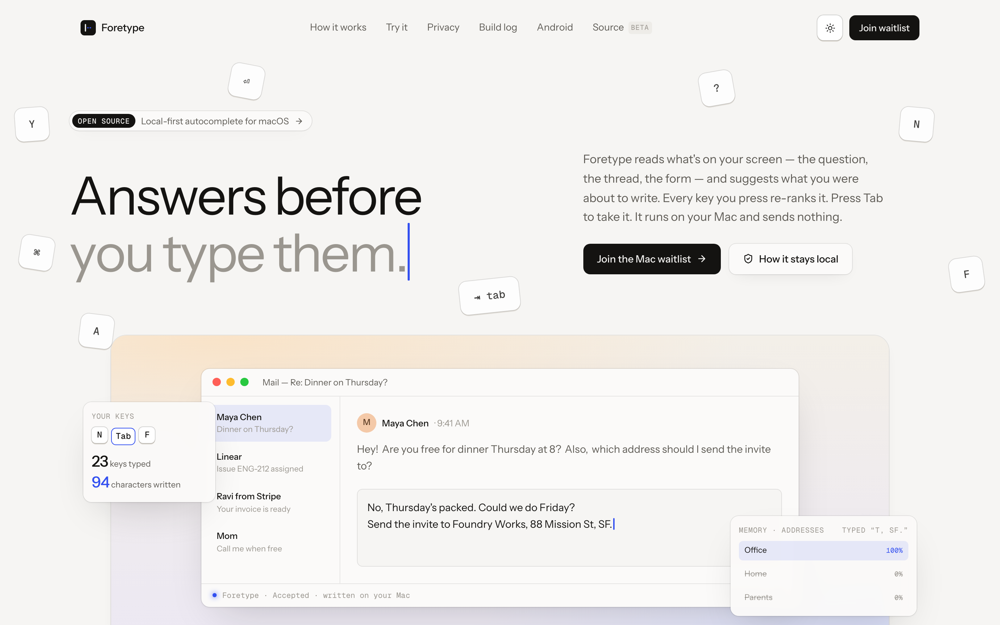
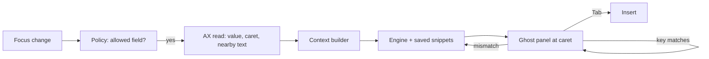

<div align="center">

# Foretype

**Local-first autocomplete for macOS. It reads the question on your screen and suggests the answer before you type it.**

[](LICENSE)


[Website](https://foretype.vercel.app) · [Plan](docs/PLAN.md) · [Research](docs/RESEARCH.md) · [Dev log](docs/DEVLOG.md)

<picture>
  <source media="(prefers-color-scheme: dark)" srcset="docs/assets/hero-dark.png">
  
</picture>

</div>

## What it does

- **Reads the screen context.** It looks at the focused field and the text around it: the email you are replying to, the form label, the window title.
- **Suggests the answer, not just the next word.** A small local model drafts a short continuation. It shows as grey ghost text at your caret.
- **Re-ranks on every key.** Press Tab to accept. Press Esc to dismiss. Keep typing and the suggestion adapts.

Example. A form asks "Is the billing address the same as shipping?" You type `y` and Foretype shows `yes`. You type `n` instead and it switches to `no`. In an address field you type `H` and see your Home address. You type `O` and it switches to Office. Saved snippets match by prefix, so this needs no model call.

## Why local

Your screen holds mail, chats, forms and passwords. A tool that reads it should not send it anywhere.

Foretype runs the model on your Mac. There is no account, no analytics, no crash reporting and no update ping.

### Privacy model

- **The only network call is the model download.** It happens once, after you agree, and the file is checked against a SHA-256 hash. After that the app makes no network calls. This is a code guarantee you can audit in the source. It is not an OS-level lock, so you can also check it with a firewall such as LuLu or Little Snitch.
- **Accessibility permission only.** No Screen Recording, no Input Monitoring.
- **Context lives in memory.** It is dropped when a field loses focus. Nothing is written to disk.
- **Skipped by default.** Secure fields, password managers, banking apps, Keychain Access and Terminal.
- **No clipboard.** Foretype never uses the clipboard to insert text.
- **Audit panel.** A "Show me what you read" panel shows the context for the field you are in now. It clears on blur.
- **Snippets are encrypted** on disk, and the key lives in the Keychain.

## Status and roadmap

Foretype is pre-alpha. **The app is not usable yet.** Do not look for a download.

### v0.1

- [x] Website live
- [x] Build plan written and independently reviewed
- [ ] P0 spikes (in progress): signing, Accessibility, event taps, model benchmark
- [ ] Core: suggestion session, ranker, policy, snippets
- [ ] Engine: local model behind one protocol, model download with consent
- [ ] Mac adapters: focus, AX reader, key taps, inserter, ghost panel
- [ ] Menu bar app, onboarding, settings
- [ ] Offline eval harness and published results
- [ ] End-to-end tests across real apps
- [ ] First release zip

### Later

Opt-in canvas-app support (Google Docs, Figma) through on-screen text recognition, a multilingual model tier, a notarized build, Homebrew cask, and an optional cloud model. See [docs/PLAN.md](docs/PLAN.md).

## How to install

> **Coming with v0.1.** The steps below are the intended flow. They do not work yet.

### (a) Download the release

1. Download the release zip from the GitHub Releases page.
2. Move `Foretype.app` to `/Applications`.
3. The app is unsigned until it is notarized, so remove the quarantine flag:

   ```sh
   xattr -dr com.apple.quarantine /Applications/Foretype.app
   ```

### (b) Build from source

You need Xcode 27 or the Command Line Tools, on Apple Silicon.

```sh
git clone https://github.com/ChiragJaju/foretype.git
cd foretype/app
./scripts/bundle.sh
```

The script builds a release binary and wraps it into `Foretype.app`. A helper, `scripts/dev-sign.sh`, creates a local self-signed identity. Your permission grant then survives rebuilds.

### (c) Grant Accessibility

Open **System Settings → Privacy & Security → Accessibility** and turn on Foretype. That is the only permission it needs. It takes effect at once, with no relaunch.

### (d) First-run model download

On first run Foretype asks before it downloads anything. It shows the size, the source URL and the expected SHA-256. The model is about 0.6 to 1.6 GB, depending on which one you pick. The file is verified before it is used. If you decline, it falls back to saved snippets only, or to Apple's on-device model when available.

### (e) Uninstall

1. Quit Foretype from the menu bar.
2. Delete `/Applications/Foretype.app`.
3. Remove it from **Privacy & Security → Accessibility**.
4. Delete the downloaded model and your snippets from Foretype's folder in `~/Library/Application Support`.
5. Remove its Keychain item (the snippet key) in Keychain Access.

## How it works



1. Foretype watches which field has focus.
2. A policy check drops secure fields and deny-listed apps.
3. It reads the field, the caret and up to about 1,500 characters of nearby text through the Accessibility API.
4. The engine drafts at most 24 tokens. Snippets rank first when the field looks like an address or email, or when the typed prefix matches one.
5. Typing a matching letter trims the suggestion with no model call. A mismatch asks the engine again.
6. Tab inserts the text. Insertion tries the Accessibility API first, then tagged Unicode key events, and checks that the text landed.

Full details are in [docs/PLAN.md](docs/PLAN.md).

## Supported apps

All rows are **planned and being verified**. Nothing here is a promise yet.

| Status | Apps |
|---|---|
| Works (target) | TextEdit, Notes, Mail, Safari and Chrome text fields, native Cocoa fields |
| Partial (expected) | Electron apps such as Slack and Discord, VS Code, other web editors |
| Not yet | Canvas apps (Google Docs, Figma), Terminal, secure fields, password managers |

## FAQ

**Does any text leave my Mac?**
No. The only network call is the one-time model download, after you agree. See the privacy model above.

**Why not use Screen Recording?**
Accessibility gives real text, uses less power, and needs no monthly permission prompt on macOS 15 and later. Screen capture is planned only as an opt-in fallback for canvas apps.

**Which model does it use?**
The default is chosen by benchmark. Candidates are Qwen3.5 0.8B and 2B base models (Apache-2.0), run through MLX or llama.cpp. The choice is not final.

**How is it different from Cotypist, Cotabby or Pretype?**
They complete the text you are writing. Foretype also answers from what is on screen, and keeps your own snippets for things like addresses. See [docs/RESEARCH.md](docs/RESEARCH.md).

**Will it work on Intel Macs or older macOS?**
Not in v0.1. It targets macOS 26 and later on Apple Silicon (developed and tested on macOS 27).

**Is there a Windows, iOS or Android version?**
No. iOS has no way to draw over the system keyboard, and Android needs a keyboard of its own. Desktop comes first. The reasoning is in [docs/RESEARCH.md](docs/RESEARCH.md).

## Contributing

Read [CONTRIBUTING.md](CONTRIBUTING.md). Report security issues as described in [SECURITY.md](SECURITY.md).

## License

[MIT](LICENSE). Website: <https://foretype.vercel.app>
